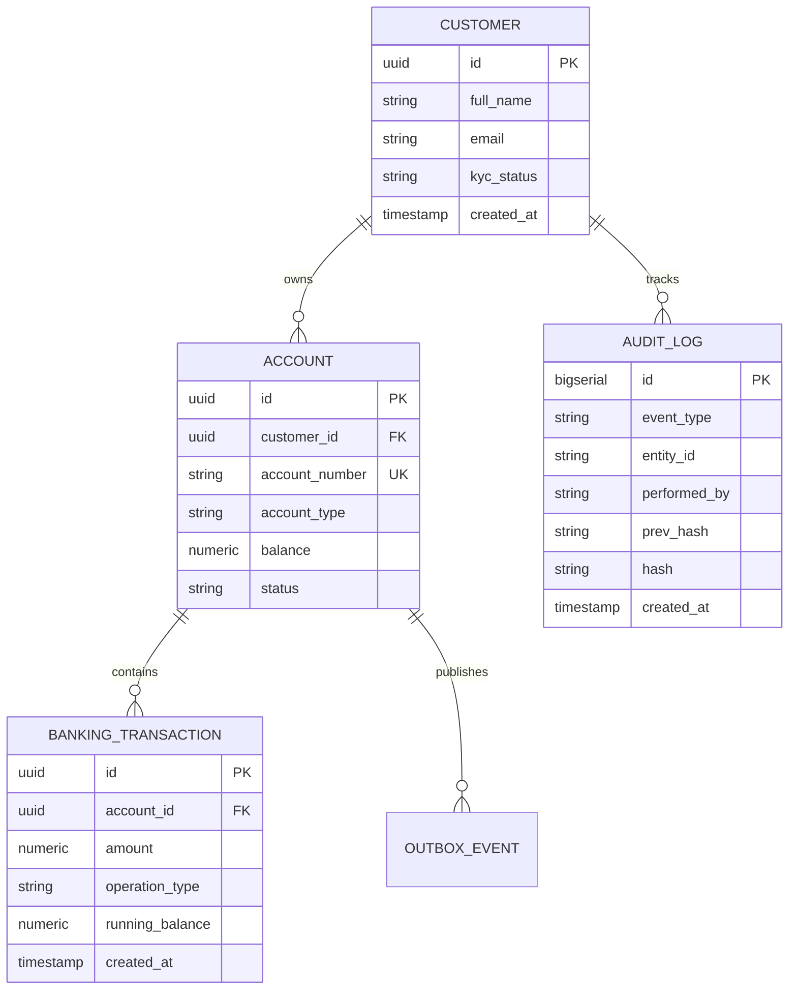
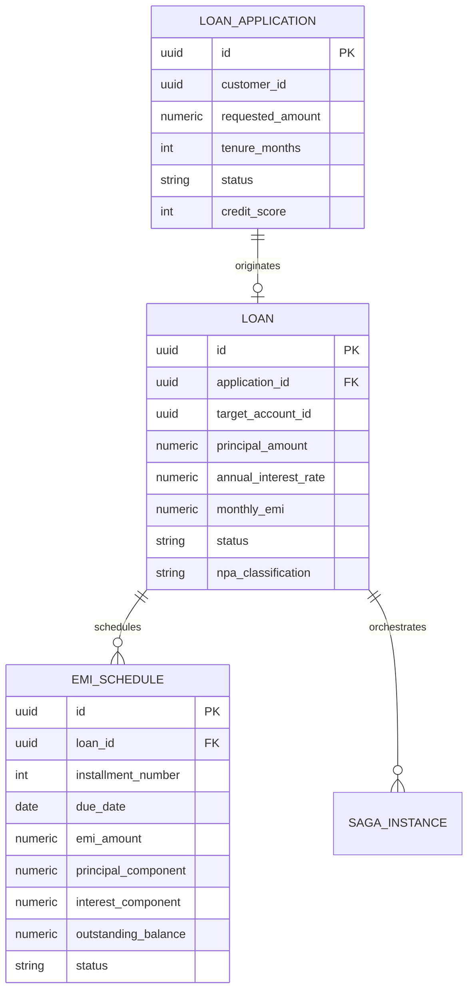
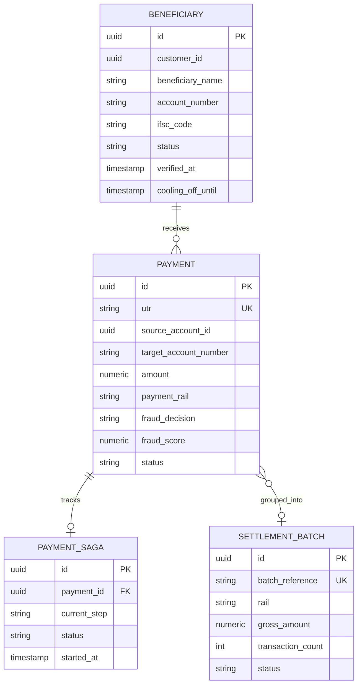
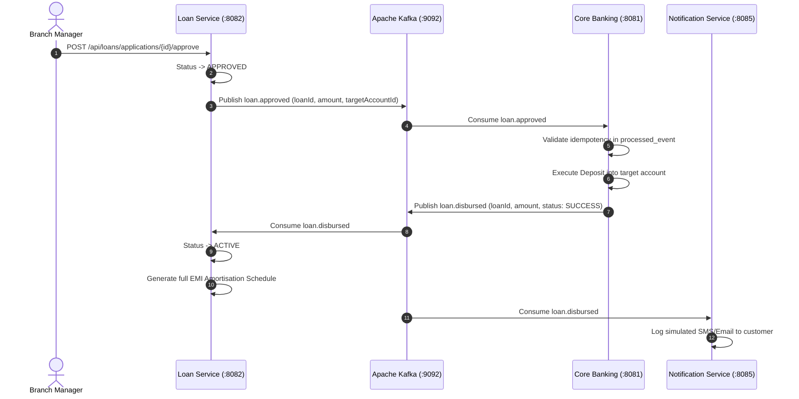
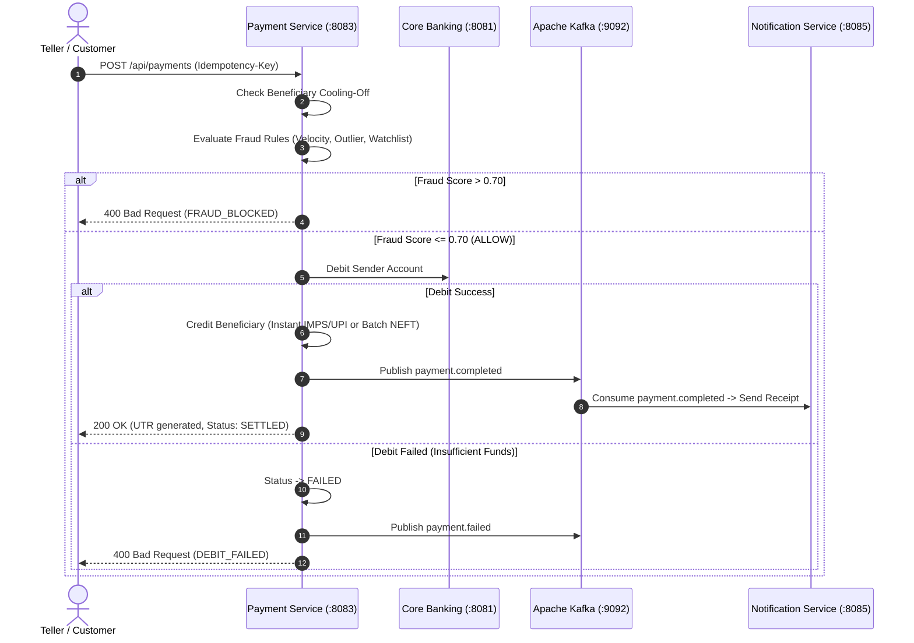

# FinCore Nexus — Enterprise Architecture & System Design

FinCore Nexus is an enterprise-grade digital banking and payment platform architected according to strict Domain-Driven Design (DDD), microservice boundary separation, and event-driven choreography.

---

## 1. The 9 Enterprise Architecture Layers

| Layer | Architecture Layer | FinCore Nexus Implementation & Directory | Primary Responsibilities |
|---|---|---|---|
| **1** | **Edge & Gateway Layer** | `services/api-gateway/`, `frontend/nginx.conf` | Reverse proxy routing, SSL termination, Redis rate limiting (120 req/min), CORS headers |
| **2** | **Identity & Access Management (IAM)** | `infra/keycloak/`, Spring Security RBAC | Dual Maker-Checker authorization, JWT validation, HTTP Basic fallback |
| **3** | **Core Banking & Ledger Layer** | `services/core-banking-services/` | Double-entry ledger, accounts, balance cache-aside, immutable SHA-256 audit trail |
| **4** | **Lending & Credit Amortisation Layer** | `services/loan-service/` | Deterministic scoring engine, `DECIMAL128` EMI amortisation, disbursement SAGA |
| **5** | **Payment Orchestration & Clearing Layer**| `services/payment-service/` | IMPS/UPI/NEFT rails, rule fraud engine, payment SAGA, T+0 & batch settlement |
| **6** | **KYC & Regulatory Compliance Layer** | `services/kyc-service/` | Verhoeff Aadhaar, PAN validation, AES-256-GCM encryption at rest, PCI-DSS evaluation |
| **7** | **Messaging & Event Streaming Mesh** | `fincore-kafka:9092`, `docs/events.md` | Distributed Kafka event topics, transactional outbox relay, idempotent consumers |
| **8** | **Data Persistence & Cache Layer** | PostgreSQL 17 (`fincore_*`), Redis 7 | Dedicated schemas per microservice, 60s balance cache, hash-chained ledgers |
| **9** | **Presentation & User Experience Layer** | `frontend/src/` (React 19 + Tailwind CSS) | Unified Master Dashboard, staff workstations, and self-service customer portal |

---

## 2. Microservice Topology

```mermaid
flowchart TB
    Client["Browser / Client App"] -->|HTTPS :80 / :5173| Frontend["React Frontend (Nginx)"]
    Client -->|HTTPS :8080| Gateway["API Gateway (:8080)"]
    Frontend -->|Proxy /api| Gateway

    subgraph Security & Cache
        Keycloak["Keycloak IAM (:8089)"]
        Redis[("Redis 7 (:6379)\nBalance Cache & Rate Limiting")]
    end

    Gateway -->|Rate Limit Check| Redis
    Gateway -->|/api/accounts, /api/customers| Core["Core Banking (:8081)"]
    Gateway -->|/api/loans| Loan["Loan Service (:8082)"]
    Gateway -->|/api/payments| Payment["Payment Service (:8083)"]
    Gateway -->|/api/kyc, /api/compliance| KYC["KYC Service (:8084)"]
    Gateway -->|/api/notifications| Notification["Notification Service (:8085)"]

    subgraph Kafka Event Mesh
        Kafka{{"Apache Kafka 4.0 (:9092)\nTopics: loan.*, payment.*, kyc.*"}}
    end

    Core <-->|Kafka Events| Kafka
    Loan <-->|Kafka Events| Kafka
    Payment <-->|Kafka Events| Kafka
    KYC <-->|Kafka Events| Kafka
    Notification <--|Kafka Events| Kafka

    subgraph Database Isolation
        DBCore[("fincore")]
        DBLoan[("fincore_loan")]
        DBPay[("fincore_payment")]
        DBKyc[("fincore_kyc")]
        DBNotif[("fincore_notification")]
    end

    Core --- DBCore
    Loan --- DBLoan
    Payment --- DBPay
    KYC --- DBKyc
    Notification --- DBNotif
```

---

## 3. Entity Relationship (ER) Diagrams

### Core Banking Database (`fincore`)


### Loan Management Database (`fincore_loan`)


### Payment Orchestration Database (`fincore_payment`)


---

## 4. SAGA Sequence Choreography

### Event-Driven Loan Disbursement SAGA


### Payment Clearing & Settlement SAGA

