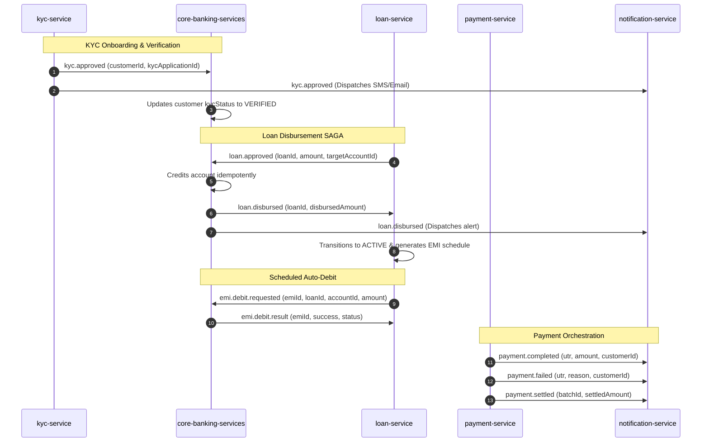

# FinCore Nexus — Distributed Event Catalogue

FinCore Nexus enforces strict microservice boundary isolation. Services **never share databases** and communicate exclusively via asynchronous event streams in Apache Kafka or synchronous REST through the API Gateway.

All event consumers implement **distributed idempotency** backed by a `processed_event` table storing the event's unique correlation or idempotency key.

---

## Event Topics & Choreography

### Transactional Outbox Pattern (Across All Event Producers)
All asynchronous event publications originate via the **Transactional Outbox Pattern**:
1. Business state changes and an `OutboxEvent` are committed atomically within the same local PostgreSQL database transaction.
2. A dedicated `@Scheduled(fixedDelay = 500)` `OutboxRelay` continuously polls unsent outbox rows (`sentAt IS NULL`), publishes to Apache Kafka with guaranteed entity-deterministic partition keys, awaits broker ACK, and marks the event as `sent_at = NOW()`.
3. If Kafka or broker connection is temporarily unavailable at the exact moment of transaction commit, no events are lost; the relay delivers them on the next tick (at-least-once delivery).
4. All downstream consumers maintain idempotent processing via unique key checks against their local `processed_event` tables.

| Service | Event Topic | Aggregate Type | Deterministic Message Key | Outbox Table |
|---|---|---|---|---|
| `core-banking-services` | `transaction.completed` | `Account` | `accountId` | `core.outbox_event` |
| `loan-service` | `loan.approved` | `Loan` | `loanId` | `fincore_loan.outbox_event` |
| `loan-service` | `emi.debit.requested` | `EmiSchedule` | `emiId` / `loanId` | `fincore_loan.outbox_event` |
| `payment-service` | `payment.initiated` | `Payment` | `paymentId` | `fincore_payment.outbox_event` |
| `payment-service` | `payment.completed` | `Payment` | `paymentId` | `fincore_payment.outbox_event` |
| `payment-service` | `payment.failed` | `Payment` | `paymentId` | `fincore_payment.outbox_event` |
| `payment-service` | `payment.settled` | `Payment` | `paymentId` | `fincore_payment.outbox_event` |
| `kyc-service` | `kyc.approved` | `Customer` | `customerId` | `fincore_kyc.outbox_event` |
| `kyc-service` | `kyc.rejected` | `Customer` | `customerId` | `fincore_kyc.outbox_event` |



---

## Topic Specifications

### 1. `kyc.approved`
- **Producer**: `kyc-service` (`KycService.java`)
- **Consumers**:
  - `core-banking-services` (`KycEventConsumer.java`)
  - `notification-service` (`NotificationEventListener.java`)
- **Key**: `customerId` (UUID String)
- **Payload Schema**:
```json
{
  "customerId": "a0000000-0000-0000-0000-000000000001",
  "kycApplicationId": "c0000000-0000-0000-0000-000000000001",
  "fullName": "Aarav Sharma",
  "panMasked": "ABCXXXX34F",
  "approvedAt": "2026-11-14T10:15:30Z"
}
```
- **Semantics**: Idempotently unlocks account opening and deposits for the customer.

---

### 2. `kyc.rejected`
- **Producer**: `kyc-service`
- **Consumers**:
  - `core-banking-services`
  - `notification-service`
- **Key**: `customerId` (UUID String)
- **Payload Schema**:
```json
{
  "customerId": "a0000000-0000-0000-0000-000000000001",
  "kycApplicationId": "c0000000-0000-0000-0000-000000000001",
  "reason": "PAN card photo does not match biometric selfie",
  "rejectedAt": "2026-11-14T10:15:30Z"
}
```

---

### 3. `loan.approved`
- **Producer**: `loan-service` (`LoanService.java`)
- **Consumers**: `core-banking-services` (`LoanCommandConsumer.java`)
- **Key**: `loanId` (UUID String)
- **Payload Schema**:
```json
{
  "loanId": "d0000000-0000-0000-0000-000000000001",
  "customerId": "a0000000-0000-0000-0000-000000000001",
  "targetAccountId": "b0000000-0000-0000-0000-000000000001",
  "amount": 250000.00,
  "correlationId": "saga-loan-disburse-d0000000"
}
```
- **Semantics**: SAGA step 1. Core banking validates target account, idempotently credits funds, and produces `loan.disbursed`.

---

### 4. `loan.disbursed`
- **Producer**: `core-banking-services` (`LoanCommandConsumer.java`)
- **Consumers**:
  - `loan-service` (`LoanEventListener.java`)
  - `notification-service` (`NotificationEventListener.java`)
- **Key**: `loanId` (UUID String)
- **Payload Schema**:
```json
{
  "loanId": "d0000000-0000-0000-0000-000000000001",
  "disbursedAmount": 250000.00,
  "transactionId": "e0000000-0000-0000-0000-000000000001",
  "status": "SUCCESS",
  "disbursedAt": "2026-11-14T10:16:00Z"
}
```
- **Semantics**: Completes SAGA. Loan transitions to `ACTIVE` and generates full amortisation schedule.

---

### 5. `emi.debit.requested`
- **Producer**: `loan-service` (`AutoDebitScheduler.java`)
- **Consumers**: `core-banking-services` (`LoanCommandConsumer.java`)
- **Key**: `loanId` (UUID String)
- **Payload Schema**:
```json
{
  "emiId": "f0000000-0000-0000-0000-000000000001",
  "loanId": "d0000000-0000-0000-0000-000000000001",
  "accountId": "b0000000-0000-0000-0000-000000000001",
  "amount": 7500.00,
  "idempotencyKey": "debit-emi-f0000000-20261114"
}
```

---

### 6. `emi.debit.result`
- **Producer**: `core-banking-services`
- **Consumers**: `loan-service`
- **Key**: `loanId` (UUID String)
- **Payload Schema**:
```json
{
  "emiId": "f0000000-0000-0000-0000-000000000001",
  "loanId": "d0000000-0000-0000-0000-000000000001",
  "success": true,
  "status": "PAID",
  "processedAt": "2026-11-14T10:16:30Z"
}
```

---

### 7. `payment.completed`
- **Producer**: `payment-service` (`PaymentService.java`)
- **Consumers**: `notification-service` (`NotificationEventListener.java`)
- **Key**: `paymentId` (UUID String)
- **Payload Schema**:
```json
{
  "paymentId": "70000000-0000-0000-0000-000000000001",
  "customerId": "a0000000-0000-0000-0000-000000000001",
  "utr": "IMPS202611141000000001",
  "amount": 15000.00,
  "paymentRail": "IMPS",
  "status": "SETTLED",
  "completedAt": "2026-11-14T10:17:00Z"
}
```

---

### 8. `payment.failed`
- **Producer**: `payment-service`
- **Consumers**: `notification-service`
- **Key**: `paymentId` (UUID String)
- **Payload Schema**:
```json
{
  "paymentId": "70000000-0000-0000-0000-000000000001",
  "customerId": "a0000000-0000-0000-0000-000000000001",
  "utr": "IMPS202611141000000002",
  "amount": 75000.00,
  "reason": "Cooling-off active for newly added beneficiary",
  "failedAt": "2026-11-14T10:17:30Z"
}
```

---

### 9. `transaction.completed`
- **Producer**: `core-banking-services` (`OutboxRelay.java`)
- **Consumers**: `notification-service`
- **Key**: `transactionId` (UUID String)
- **Payload Schema**:
```json
{
  "transactionId": "80000000-0000-0000-0000-000000000001",
  "accountId": "b0000000-0000-0000-0000-000000000001",
  "amount": 5000.00,
  "operation": "DEPOSIT",
  "timestamp": "2026-11-14T10:18:00Z"
}
```
